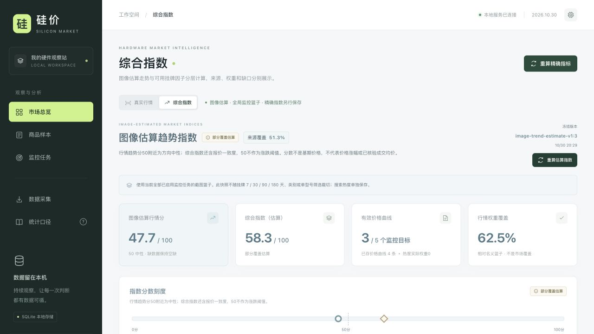
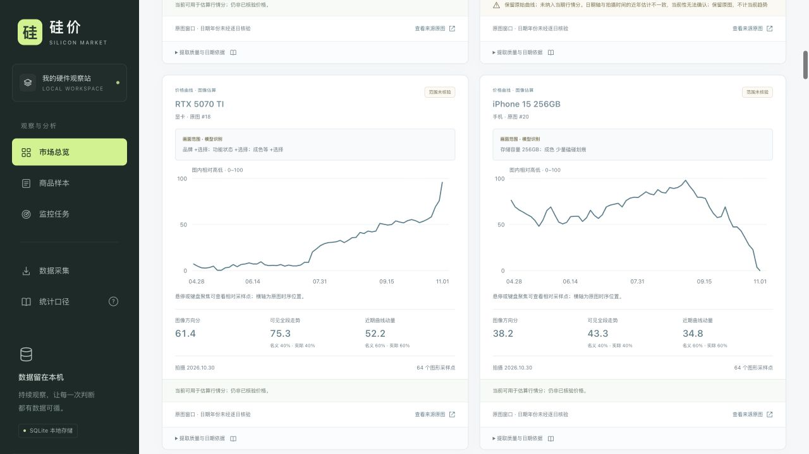
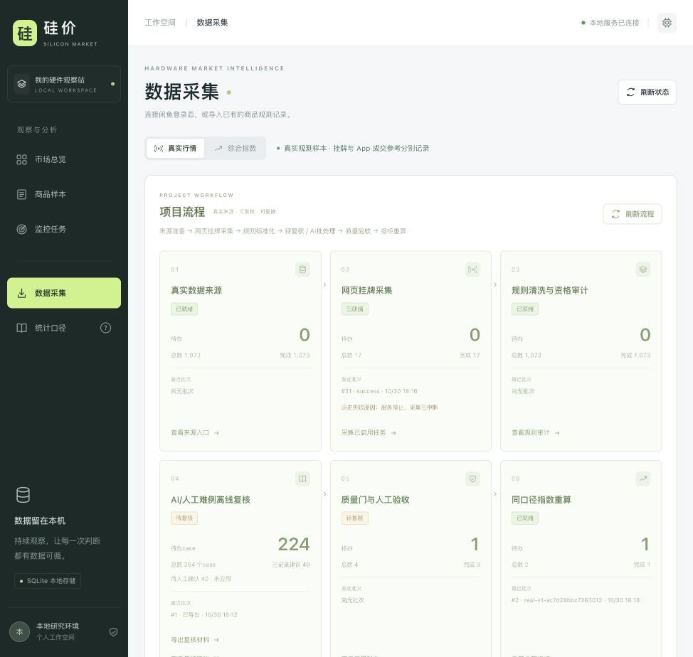

# 硅价 · Silicon Market

**v0.0.1 · 本地闲鱼硬件与手机行情观察系统**

持续记录显卡、内存、CPU、主板、存储、电脑整机、手机和元件的挂牌样本，并将原始观测、截图证据、估算趋势和严格价格读数分开保存。适合从明确型号开始积累自己的观察数据。

[使用指南](docs/USAGE.md) · [v0.0.1 发布说明](docs/RELEASE_NOTES_v0.0.1.md) · [项目工作流程](docs/PROJECT_WORKFLOW.md) · [开源调研](docs/RESEARCH.md)



> 截图来自开发验收工作区，用于展示界面与统计口径。发行包不包含该工作区的数据库、登录态或原始手机图片；首次安装空库、曲线为空、指数显示数据不足均属正常。

## 这个版本可以做什么

| 功能 | 说明 |
| --- | --- |
| 网页挂牌采集 | 使用本机登录的浏览器，按监控任务持久排队、去重并记录每次观测与失败原因 |
| 型号与质量处理 | 区分显存、内存容量、手机存储等规格，标记故障、配件、求购、整机组合及报价单位问题；原始记录保留 |
| 市场观察 | 查看挂牌价格分布、每日样本走势、首次发现数量、状态历史及有证据的样本售出占比 |
| 截图先行 | 手机可用时先归档真实截图，之后处理图片；图片哈希、目标范围、版本和识别建议可追溯 |
| 图像估算趋势 | 从原图曲线得到相对趋势分，公开分项、名义/实际权重、来源覆盖和排除原因 |
| 严格读数与指数 | 已核验日期价格、App近7日成交均价与挂牌价格分开；严格指数继续遵守样本及历史成熟门槛 |
| 本地工作流 | JSON / JSONL / CSV导入导出、规则审计、复核材料包、建议登记与冻结指数版本 |

<details>
<summary>查看型号趋势与项目流程截图</summary>



相对曲线纵轴为图内0–100位置，不是人民币或涨跌百分比。



素材范围和来源见[公开展示素材说明](docs/assets/README.md)。这些展示图不会为新安装生成行情数据。

</details>

## 快速开始

需要 **Python 3.11+**，推荐使用`uv`管理依赖。网页核心可用于macOS、Windows和Linux；本机iPhone镜像驱动是macOS可选能力。**Node.js 22+**仅用于本地手机运行器、可选适配器与Node测试，运行网页核心不需要另装Node。

下载发行包`silicon-market-v0.0.1.zip`并解压，或克隆仓库，然后在包含`pyproject.toml`的项目目录执行：

```bash
uv sync --locked
uv run playwright install chromium
uv run uvicorn app.main:app --host 127.0.0.1 --port 8765 --workers 1
```

打开`http://127.0.0.1:8765`，按`Ctrl+C`停止服务。macOS / Linux也可使用`./start.sh`，自定义端口示例为`./start.sh 8877`；macOS另有[双击启动入口](启动硅价.command)。Windows的pip备用安装方式见[使用指南](docs/USAGE.md#安装与启动)。

首次运行会建立本地SQLite库和暂停状态的示例监控任务，**不注入演示行情，也不自动启动手机**。没有真实采集或导入，就不会出现发布截图中的数据。

### 第一次采集

1. 进入“数据采集”，打开本机登录窗口，在闲鱼网页完成扫码和必要验证。
2. 在“监控任务”创建具体目标，例如`RTX 4070 SUPER`或`DDR5 32G 6000`，核对分类和型号。
3. 先单次运行，查看商品样本与日志；确认结果后再启用定时监控。采集间隔至少30分钟，服务须保持运行。
4. 回到“市场总览”查看自己的真实观测。也可从“数据采集”导入已有记录。

每轮最多读取一页搜索、至多40件商品，并复查至多10件已跟踪商品。平台登录或验证失败会明确记录，不作为零商品行情；搜索中消失也不会自动认定为已售。

## 怎样读这些图和指数

| 数据层 | 可以表达什么 | 不能替代什么 |
| --- | --- | --- |
| 真实挂牌观测 | 实际采到的标价、观测时间和商品状态 | 最终议价成交价、全市场供给或过去半年的未观测数据 |
| 图像估算趋势 | 原图曲线的相对方向和近期形态，0–100分，50附近为方向中性或平衡 | 人民币价格指数、价格涨幅、精确逐日价格 |
| 已核验App读数 | 指定日期及实际容量、成色范围下的近7日成交均价 | 当日成交均价或所有成色的行情 |
| 严格价格与五因子指数 | 在共同基期、固定篮子、成熟队列等条件满足后的真实输入计算 | 用缺失值补出的综合分 |

图像综合指数名义权重为**趋势70% + 真实挂牌报价一致度30%**，必须存在有效趋势。部分来源缺失时展示实际权重和来源覆盖，不补0或50。搜索热度、异常时间轴和无法匹配的经济范围单独标记；“近期”指原图可见区间，不能直接解释成固定7日或28日。详细定义见[截图趋势指数](docs/IMAGE_TREND_INDEX.md)。

严格指数仍独立保留其门槛，不会被估算层覆盖。新增观测不等于新发布，挂牌价不等于成交价，样本售出占比不等于全市场成交率。

## 日常命令

服务运行后，可在macOS / Linux使用：

```bash
./project.sh status
./project.sh collect
./project.sh collect --task-id 1 --wait
./project.sh review-export
./project.sh audit-preview
```

`collect`默认只持久入队；`--wait`才等待真实终态。`daily --wait`依次处理网页主线、规则审计和质量检查，通过条件后重建严格指数；它不会操作手机或自动应用AI建议。图像估算指数在“综合指数”页面通过“重算估算指数”另行生成。

Windows或不使用shell脚本时，入口等价为`uv run python -m app.project_cli status`。自定义服务端口的`--base-url`须放在子命令之前。更多命令见[使用指南](docs/USAGE.md#日常工作流)。

## 可选：手机截图与识别

手机只允许处理**当前已启用且来源为live的监控任务**，不会从历史目录扩展到全部型号。无法确定型号、设备锁定或缺少权限时保持等待；范围未核对的图片可待审归档，但不能形成严格价格点。停用或删除任务会撤销继续采集的资格。

macOS上需有可用的iPhone镜像应用、兼容设备、Apple Command Line Tools及Node.js 22+，然后可构建可选组件：

```bash
bash automation/build_ocr.sh
bash automation/build_native.sh
```

构建不会请求系统权限或操作手机。辅助功能、屏幕录制、手机解锁和App验证均由本人完成；手机进程需明确启停，镜像不在前台时不会自动抢回焦点。截图优先执行器还需已授权的MCP/CUA会话注入，并非安装后自动可用的手机后台服务。详见[手机使用步骤](docs/USAGE.md#可选手机支线)与[原生驱动说明](docs/NATIVE_MOBILE_DRIVER.md)。

开发期间，当前Codex会话中的`gpt-6.1-sol`已实际识读保存图片，结果仍作为建议保存。该会话不会随发行包迁移；独立CLI图片请求**尚未验证成功**，不作为已接通的常驻识图能力宣传。网页采集和本地图片队列无需依赖该会话持续在线。

## 本地数据与开发

数据库默认在`data/market.sqlite3`，浏览器资料和原始证据也保存在本机。`data/`、`output/`、登录态、运行日志、原生二进制和模型会话不随发行包提供。更换机器后需要重新登录和积累数据；备份、迁移及统计口径见[使用指南](docs/USAGE.md#数据与维护)。

```bash
uv sync --group dev
uv run pytest -q
node --test tests/*.mjs
```

Node测试需要Node.js 22+。测试使用隔离数据和mock；不替代真实账号、设备与平台访问条件的现场验证。核心结构为FastAPI、SQLite、Playwright和静态HTML/CSS/JavaScript，不需要前端构建。

进一步阅读：[发布说明](docs/RELEASE_NOTES_v0.0.1.md)、[详细流程](docs/PROJECT_WORKFLOW.md)、[历史验收记录](docs/EXECUTION_STATUS.md)、[API约定](API_CONTRACT.md)、[执行接口](docs/EXECUTION_CONTRACT.md)。历史文档中的本机数据路径与数值是开发验收记录，发布包不包含其原始证据。
